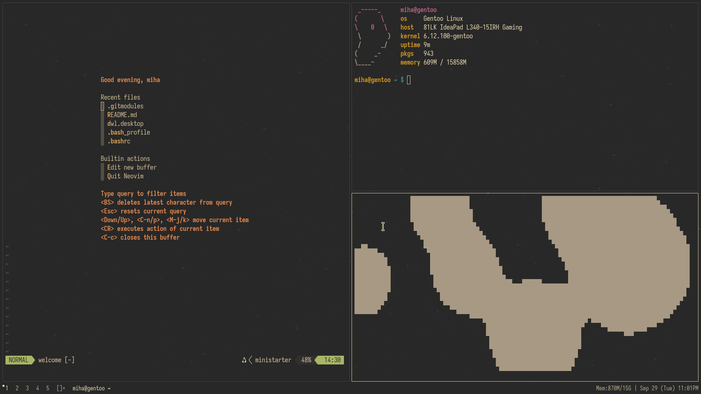
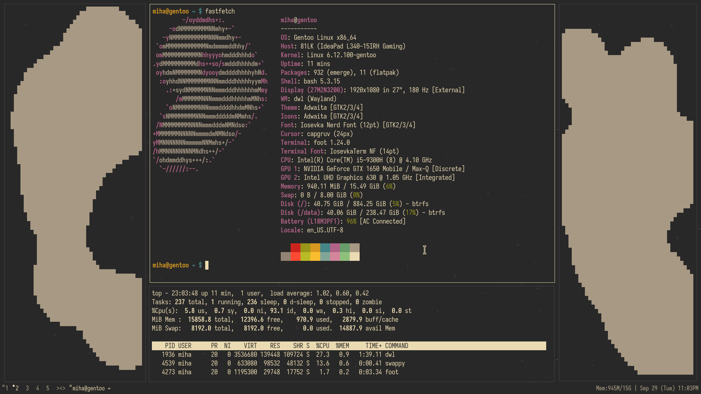

# dotfiles

My dotfiles, cursors and wallpapers (all stowable)

---

## Preview




---

## Installation

**Firstly, install <u>GNU stow</u> from [here](https://www.gnu.org/software/stow/) or by using your favorite package manager**

**Then, ensure you have `git` and clone repo by running**

```sh
git clone --recurse-submodules https://git.sr.ht/~miha77777ua/.dotfiles
```

**Then, cd into cloned repo**

```sh
cd dotfiles
```

**Run `stow` for every package (ensure `~/.local/share/icons`, `~/.config` and `~/.Pictures` exist before stowing, otherwise `stow` will create symlinks for them)**

```sh
stow <name of the package, like nvim>
```
