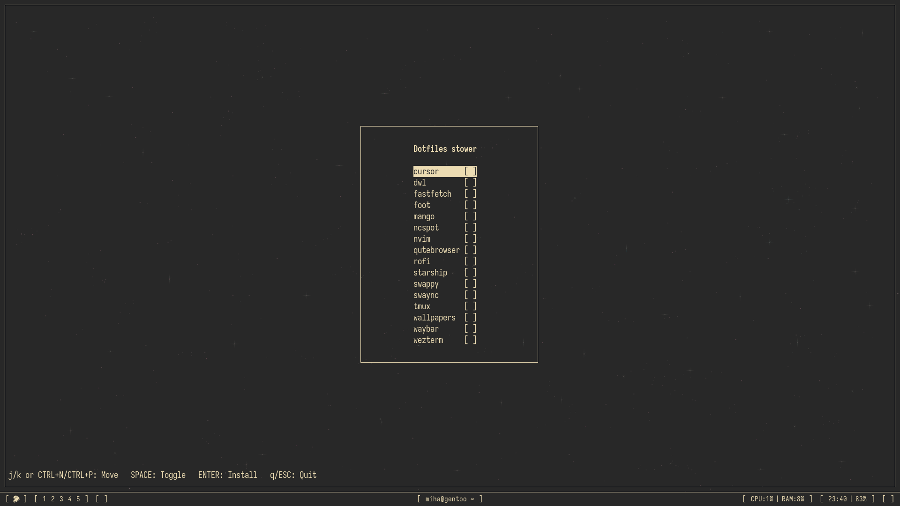

# dotfiles✨

**This a small repo which contains my dotfiles, cursors and wallpapers (all stowable) and also a simple [TUI installer](https://codeberg.org/Miha777777ua/installer) for them**

---

## Preview




---

## Installation

**Firstly, install <u>GNU stow</u> from [here](https://www.gnu.org/software/stow/) or by using your favorite package manager**

**Then, ensure you have `git` and clone repo by running**

```sh
git clone --recurse-submodules https://codeberg.org/Miha777777ua/.dotfiles.git
```

**Then, cd into cloned repo**

```sh
cd dotfiles
```

**There are two methods: with <u>TUI installer</u> or <u>manually</u>**

### 1. TUI installer

**`make` is required**

**Simply run**

```sh
./install
```

**It's a shell script, which will compile simple ncurses program, written in c, which is located in `installer` subdir**

### 2. Manual installation

**Run `stow` for every package (ensure `~/.local/share/icons` and `~/.config` exist before stowing, otherwise `stow` will create symlinks for them)**

```sh
stow <name of the package, like nvim>
```
